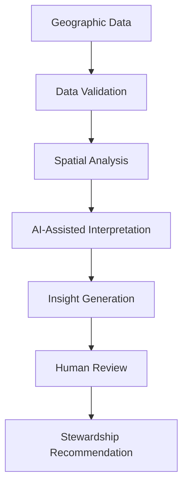
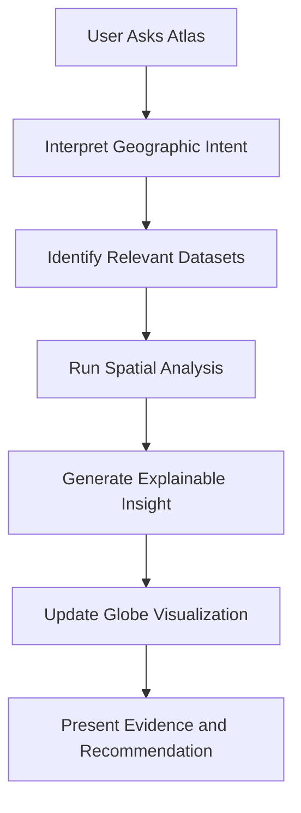
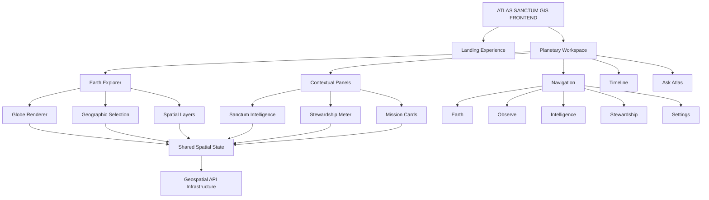

# 🌍 ATLAS SANCTUM GIS
## The Planetary Stewardship Operating System

### One Earth. One Map. Infinite Wisdom.

<p align="center">
  <strong>STEWARD THE WORLD.</strong>
  <br/>
  <em>A living planetary observatory where geographic intelligence, artificial intelligence, ethics, and regenerative action converge.</em>
</p>

<p align="center">
  <a href="#-vision">Vision</a> •
  <a href="#-experience">Experience</a> •
  <a href="#-core-systems">Core Systems</a> •
  <a href="#-architecture">Architecture</a> •
  <a href="#-roadmap">Roadmap</a>
</p>

---

# 🌎 01. The Vision

Geography is more than the study of places.

It is the study of relationships between people, ecosystems, resources, infrastructure, climate, and the living systems that sustain civilization.

Yet conventional Geographic Information Systems often present this complexity through fragmented layers, disconnected dashboards, and interfaces designed primarily for technical specialists.

**Atlas Sanctum GIS proposes a different experience.**

A planetary intelligence environment where the Earth becomes the central interface for understanding our world, discovering opportunities, anticipating risks, and coordinating meaningful action.

We envision an interactive digital atlas where:

- Nature becomes observable through environmental intelligence.
- Cities reveal their interconnected infrastructure and development patterns.
- Communities become visible within their geographical and socioeconomic contexts.
- Water, forests, agriculture, and biodiversity can be explored together.
- AI transforms complex geospatial information into actionable insights.
- Historical observations reveal how places evolve over time.
- Future scenarios help decision-makers explore possible outcomes.
- Stewardship missions connect intelligence with real-world action.

Our ambition is to make planetary intelligence accessible, meaningful, and actionable.

**Atlas Sanctum GIS is not simply a map viewer. It is a place where data becomes understanding, understanding becomes responsibility, and responsibility becomes stewardship.**

---

# 🏛️ 02. The Design Philosophy

The frontend should feel like entering a living planetary observatory.

Its design language combines five complementary experiences.

| Inspiration | Design Principle |
|---|---|
| NASA Mission Control | Precision, clarity, operational intelligence |
| Digital Atlas | Geographic exploration and discovery |
| Strategy Game Interface | Systems thinking, missions, and resource awareness |
| Sacred Architecture | Purpose, contemplation, and harmony |
| Apple-Level Design | Elegance, restraint, and intuitive interactions |

### The Desired Atmosphere

Awe. Wisdom. Clarity. Calm confidence. Responsibility.

The interface should invite exploration rather than overwhelm the user.

Every interaction should have a purpose. Every visualization should communicate meaning. Every insight should help users understand something about the world.

### Core Design Principle

**Reveal complexity progressively.**

The user should encounter a beautiful and understandable planetary experience first. Advanced analytical capabilities should appear only when they become relevant.

---

# 🎨 03. Visual Identity

The visual language is inspired by planetary observation, natural ecosystems, and timeless architectural design.

### Color Philosophy

| Color | Meaning | Proposed Direction |
|---|---|---|
| Deep Navy | Wisdom and depth | `#071522` |
| Forest Green | Regeneration and life | `#176B45` |
| Sanctum Gold | Hope and stewardship | `#D9B65D` |
| Aurora Blue | Intelligence and water | `#56C7E8` |
| Cloud White | Clarity and openness | `#F4F7F5` |

### Typography

- Elegant, readable typography.
- Large and meaningful headings.
- Generous spacing.
- Clear information hierarchy.
- Minimal decorative elements.
- Strong numerical readability.

### Motion Philosophy

Motion communicates calm confidence.

- The Earth rotates gently.
- The camera glides between locations.
- Geographic layers fade into view.
- Information panels slide smoothly.
- Timeline transitions feel continuous.
- AI insights appear progressively.
- Interactive elements respond without unnecessary visual noise.

Reduced-motion preferences should be respected, with static alternatives for major animations.

---

# 🛰️ 04. The MVP Experience

The first release should demonstrate one coherent experience rather than attempting to implement every possible GIS capability.

The entire MVP revolves around one central idea:

**Everything begins with the Earth.**

## 01 — Planetary Landing Experience

The user arrives at a slowly rotating 3D Earth.

The interface is deliberately minimal.

```text
┌─────────────────────────────────────────────┐
│                                             │
│                                             │
│                 ATLAS SANCTUM               │
│                                             │
│                 Steward the World.          │
│                                             │
│                                             │
│                    [ ENTER ]                │
│                                             │
│                                             │
│               ONE EARTH.                    │
│             ONE LIVING SYSTEM.              │
│                                             │
└─────────────────────────────────────────────┘
```

### Landing Experience Features

- Cinematic rotating Earth.
- Minimal institutional branding.
- Atmospheric lighting.
- Subtle geographic detail.
- Elegant entrance transition.
- Responsive rendering.
- Accessible alternative for devices that cannot render 3D graphics.

Upon entering, the Earth transitions toward a relevant starting region or a user-selected location.

The objective is to create curiosity without overwhelming the visitor.

---

## 02 — Main Workspace

After entering, the visitor arrives at the central planetary observatory.

```text
┌────────────────────────────────────────────────────────────┐
│  ATLAS SANCTUM                         Search       Profile  │
├────────────────────────────────────────────────────────────┤
│                                                            │
│  🌍 Earth                         SANCTUM INTELLIGENCE       │
│                                    Current Insight          │
│                                                            │
│             INTERACTIVE 3D EARTH       Forest cover         │
│                                        declined 2.3%         │
│                 KENYA                  Confidence            │
│                                        95%                   │
│             STEWARDSHIP SCORE           Recommendation       │
│                     84                 Protect watershed     │
│                                                            │
│                                    IMPACT: HIGH             │
│                                                            │
├────────────────────────────────────────────────────────────┤
│  INSIGHTS | RISKS | OPPORTUNITIES | MISSIONS | LAYERS      │
├────────────────────────────────────────────────────────────┤
│  2010 ────────────────●──────────────────── 2035            │
└────────────────────────────────────────────────────────────┘
```

### Workspace Principles

- The globe occupies approximately 70% of the primary workspace.
- Supporting panels remain visually secondary.
- Navigation stays minimal.
- Geographic exploration is the dominant interaction.
- Analytical information appears contextually.
- Users can expand advanced tools when necessary.

The layout should adapt gracefully to desktop, tablet, and mobile devices.

---

# 🧭 05. Core Navigation

The MVP begins with five primary navigation destinations.

| Navigation | Purpose |
|---|---|
| 🌍 Earth | Explore the planetary digital atlas |
| 📡 Observe | Examine environmental and geographic indicators |
| 🧠 Intelligence | Explore AI-generated insights and scenarios |
| ❤️ Stewardship | Discover missions and regenerative opportunities |
| ⚙ Settings | Manage preferences and platform configuration |

Navigation should remain compact and consistent.

Each destination should extend the same planetary experience rather than feeling like an unrelated application.

---

# 🌍 06. Earth Explorer
## The Living Digital Atlas

Earth Explorer is the centerpiece of Atlas Sanctum GIS.

It provides an interactive 3D globe through which users can investigate geographical locations, explore different spatial layers, and discover contextual intelligence.

### Core Interactions

Users can:

- Rotate the Earth.
- Zoom in and out.
- Search for locations.
- Click geographic features.
- Explore countries and regions.
- Toggle environmental layers.
- Navigate between geographic profiles.
- Inspect available datasets.
- Discover nearby stewardship missions.

### Geographic Profiles

Every supported geographic selection should open a contextual living profile.

Example: **Nakuru County, Kenya**

Potential profile dimensions:

| Dimension | Intelligence |
|---|---|
| Population | Population and demographic indicators |
| Water | Water resources and access |
| Forests | Forest cover and restoration |
| Food | Agricultural systems and food security |
| Climate | Climate and environmental conditions |
| Economy | Economic activity and livelihoods |
| Health | Public health and service accessibility |
| Infrastructure | Transport and essential infrastructure |
| Projects | Local development and stewardship initiatives |

Geographic profiles should distinguish between verified observations, estimates, historical measurements, and modeled indicators.

### Navigation Experience

Selecting a geographic entity should smoothly:

1. Move the globe toward the location.
2. Highlight the selected geographic boundary.
3. Display the geographic profile.
4. Reveal available intelligence layers.
5. Present relevant insights and opportunities.

---

# 🗺️ 07. The Layer System
## Six Windows Into One Planet

Instead of overwhelming users with dozens of independent GIS layers, Atlas Sanctum begins with six major thematic dimensions.

### 🌳 Nature

Explore the living systems of the planet.

Potential datasets:
- Forest cover.
- Vegetation.
- Biodiversity.
- Ecosystem conditions.
- Protected areas.
- Land degradation.

### 🏙 Cities

Understand human settlements and urban development.

Potential datasets:
- Urban boundaries.
- Population density.
- Land use.
- Settlement expansion.
- Urban infrastructure.
- Development patterns.

### 👥 People

Understand human geography and community conditions.

Potential datasets:
- Population distribution.
- Demographic indicators.
- Community infrastructure.
- Educational access.
- Socioeconomic indicators.
- Service accessibility.

### 💧 Water

Explore the planet's freshwater and aquatic systems.

Potential datasets:
- Rivers.
- Lakes.
- Watersheds.
- Water bodies.
- Water quality.
- Flood exposure.
- Water accessibility.

### 🚑 Health

Explore geographic dimensions of human wellbeing.

Potential datasets:
- Healthcare facility locations.
- Health service accessibility.
- Public health indicators.
- Emergency service coverage.
- Environmental health indicators.

Health information should use appropriately aggregated or public datasets rather than exposing identifiable patient information.

### ⚡ Infrastructure

Explore the physical systems supporting civilization.

Potential datasets:
- Transportation networks.
- Energy infrastructure.
- Utility services.
- Communication infrastructure.
- Public facilities.
- Critical infrastructure exposure.

### Layer Interaction

Every layer should:

- Fade smoothly onto the globe.
- Display a clear legend.
- Provide descriptive metadata.
- Support contextual exploration.
- Allow visibility controls.
- Communicate data freshness and provenance.

The design should prioritize visual clarity and prevent overlapping layers from becoming unreadable.

---

# 🧠 08. Sanctum Intelligence
## From Geographic Data to Actionable Wisdom

Sanctum Intelligence is the analytical assistance layer of Atlas Sanctum GIS.

It transforms complex geospatial information into understandable insights and potential actions.

Rather than displaying raw analytics without context, it aims to explain what is happening, why it matters, and what could be considered next.

### Intelligence Panel

Example demonstration:

**Current Insight**

Forest cover declined by 2.3%.

**AI Confidence**

95%.

**Recommendation**

Protect watershed.

**Estimated Impact**

High.

These values are illustrative interface content until supported by actual datasets, model evaluation, and transparent measurement methods.

### Intelligence Workflow



### Potential Capabilities

- Geographic anomaly detection.
- Environmental trend interpretation.
- Risk identification.
- Spatial pattern discovery.
- Change detection.
- Opportunity identification.
- Scenario comparison.
- Decision-support recommendations.

### Intelligence Integrity

AI-generated insights should include:

- Underlying data sources.
- Observation dates.
- Confidence or uncertainty information.
- Model limitations.
- Geographic coverage.
- Relevant methodology.
- Links to supporting evidence where available.

A model confidence score should not be confused with the probability that a recommendation is correct.

**The objective is not to replace human judgment. It is to help people understand the world more deeply.**

---

# ❤️ 09. The Stewardship Meter
## Measuring the Health of Our Relationship With Earth

Stewardship is a defining concept within Atlas Sanctum GIS.

The Stewardship Meter explores a contextual indicator of how well a geographic area supports ecological integrity, human wellbeing, resilience, and accountable governance.

### Example Interface

```text
          ┌───────────────┐
          │               │
          │      78       │
          │               │
          │  STEWARDSHIP  │
          │               │
          │   EXCELLENT   │
          │               │
          └───────────────┘
```

### Potential Measurement Dimensions

| Dimension | Example Indicators |
|---|---|
| Ecosystem Health | Forest cover, biodiversity, habitat condition |
| Resilience | Climate exposure and adaptation capacity |
| Service Access | Water, healthcare, and infrastructure access |
| Governance | Transparency and institutional indicators |
| Regenerative Progress | Restoration and verified project outcomes |

### Measurement Principles

A Stewardship Score should be:

- Evidence-based.
- Geographically contextual.
- Explainable.
- Methodologically transparent.
- Sensitive to data uncertainty.
- Comparable only where measurement conditions permit.
- Open to correction when underlying data changes.

A composite score must publish its component indicators, weighting methodology, missing-data treatment, and observation dates.

The score should not reduce complex communities or ecosystems to a simplistic public ranking.

---

# 🎯 10. Stewardship Missions
## Turn Intelligence Into Action

Stewardship Missions connect geographic intelligence with practical regenerative opportunities.

Inspired by strategy-game interfaces, they provide users with understandable objectives, estimated resource requirements, and potential outcomes.

### Example Mission Card

```text
┌─────────────────────────────────────┐
│ 🌳 RESTORE WATERSHED                │
│                                     │
│ Impact:       HIGH                  │
│ Time:         18 Months             │
│ Funding:      $2M                   │
│ Rating:       ★★★★☆                 │
│                                     │
│ Location:     Nakuru County         │
│                                     │
│          [ EXPLORE MISSION ]        │
└─────────────────────────────────────┘
```

The figures above illustrate the interface concept rather than an active funded mission.

### Potential Mission Categories

- Watershed restoration.
- Forest conservation.
- Urban green infrastructure.
- Biodiversity protection.
- Water accessibility.
- Soil regeneration.
- Community resilience.
- Sustainable infrastructure.

### Mission Interaction

Selecting a mission should:

1. Identify its geographic location.
2. Fly the camera toward the region.
3. Highlight the affected area.
4. Open the mission profile.
5. Display its objectives and evidence.
6. Show available participation opportunities.

### Mission Information

Each mission can present:

- Geographic coverage.
- Objectives.
- Environmental context.
- Current status.
- Estimated budget.
- Duration.
- Expected outcomes.
- Verification methodology.
- Responsible organizations.
- Funding and participation opportunities.

The platform should clearly separate projected impact from verified outcomes.

---

# 🔎 11. Universal Search
## One Search. The Entire Planet.

A universal search interface allows users to explore geographic entities and associated knowledge from one place.

### Search Examples

- Nakuru County.
- Rift Valley.
- Lake Nakuru.
- Mau Forest.
- River Tana.
- Hospital.
- School.
- Watershed.
- Protected area.
- Restoration project.
- Country.

### Search Experience

When a user selects a result:

1. Resolve the geographic entity.
2. Animate the globe toward its location.
3. Highlight the selected feature.
4. Open its geographic profile.
5. Load relevant datasets and insights.

### Search Capabilities

- Geographic autocomplete.
- Entity discovery.
- Administrative boundary search.
- Natural feature search.
- Project discovery.
- Dataset discovery.
- Contextual filtering.

Search results should identify ambiguous place names and distinguish between geographic entities with similar names.

---

# ⏳ 12. The Time Machine
## Explore the Past. Understand the Present. Imagine the Future.

The Timeline system introduces temporal exploration into the planetary workspace.

Users can move between historical observations, current datasets, and modeled future scenarios.

### Example Interface

```text
2010              2026               2035
 ●─────────────────●──────────────────○
                   │
              CURRENT VIEW

        HISTORICAL DATA      PROJECTION
```

### Core Capabilities

**Historical Exploration**
- Compare historical land cover.
- Examine environmental changes.
- Investigate urban expansion.
- Review infrastructure development.
- Explore historical observations.

**Present-Day Intelligence**
- Display current available datasets.
- Compare regional conditions.
- Examine recent environmental events.

**Future Scenarios**
- Explore modeled climate scenarios.
- Compare land-use alternatives.
- Examine possible restoration pathways.
- Investigate development scenarios.

### Temporal Integrity

The system must distinguish between:

- Historical measurements.
- Current observations.
- Modelled projections.
- Hypothetical scenarios.

A projection is not a prediction with guaranteed outcomes.

Its assumptions, model version, scenario parameters, and uncertainty should remain visible.

---

# 🤖 13. Ask Atlas
## An AI Copilot for Planetary Exploration

Ask Atlas is a floating conversational intelligence interface connected to the geographic workspace.

Its role is to help users explore complex geographical questions through natural language.

### Example Queries

- "Show areas at drought risk."
- "Find forests experiencing significant degradation."
- "Identify communities with limited water access."
- "Show restoration projects near Nakuru."
- "Compare historical vegetation changes."
- "Which watersheds require further investigation?"

### Interaction Model



### Copilot Capabilities

- Natural-language geographic search.
- Contextual dataset discovery.
- Spatial question interpretation.
- Map layer recommendations.
- Environmental insight summaries.
- Geographic comparisons.
- Mission discovery.
- Research assistance.

### Design Philosophy

The AI copilot should not simply return paragraphs of text.

It should communicate through the map itself.

A request should be capable of activating relevant layers, highlighting geographic areas, opening contextual profiles, and presenting evidence-backed explanations.

All consequential recommendations remain subject to human review.

---

# 🏗️ 14. Frontend Architecture

The frontend MVP should be designed around a small number of powerful components.

### Core Interface Architecture



### Component Architecture

| Component | Responsibility |
|---|---|
| PlanetaryLanding | Cinematic Earth entrance |
| GlobeView | Interactive 3D globe |
| EarthNavigation | Five-destination navigation |
| LayerController | Six thematic map layers |
| SearchCommand | Universal geographic search |
| GeographicProfile | Location-specific information |
| IntelligencePanel | Contextual analytical insights |
| StewardshipGauge | Explainable stewardship indicator |
| MissionExplorer | Geographic mission discovery |
| TimelineController | Historical and projected scenarios |
| AtlasCopilot | Conversational exploration |
| SettingsPanel | User preferences and configuration |

### State Management

The shared application state should coordinate:

- Selected geographic location.
- Globe camera position.
- Active map layers.
- Search results.
- Selected mission.
- Timeline position.
- Current intelligence context.
- Copilot interactions.

A central state model ensures that panels and geographic visualizations remain synchronized.

---

# ⚙️ 15. Technology Stack

The proposed frontend MVP uses a modern, TypeScript-based architecture.

| Layer | Technology | Purpose |
|---|---|---|
| Framework | Next.js | Application framework |
| Language | TypeScript | Type-safe development |
| Styling | Tailwind CSS | Responsive design system |
| Components | shadcn/ui | Reusable interface components |
| Animation | Framer Motion | Smooth interface transitions |
| Globe | CesiumJS | 3D planetary visualization |
| Alternative Mapping | MapLibre GL JS | Interactive geospatial rendering |
| Charts | Apache ECharts | Data visualization |
| State | Zustand | Shared application state |
| Backend | REST or GraphQL | Data and application services |

### Globe Technology Decision

For the cinematic 3D Earth experience, CesiumJS is the primary recommended option.

It provides a strong foundation for:

- 3D globe visualization.
- Geographic camera navigation.
- Terrain and imagery visualization.
- Spatial entity interaction.
- Temporal geospatial visualization.

MapLibre GL JS is an alternative for applications emphasizing fast interactive vector maps and customized 2D or 2.5D map experiences.

The MVP should select one primary rendering engine rather than introducing both without a clear architectural need.

### Frontend Engineering Principles

- Component-driven architecture.
- Reusable interface systems.
- Strict TypeScript typing.
- Responsive rendering.
- Lazy loading of heavy visualization components.
- Efficient geographic data loading.
- Smooth camera transitions.
- Accessible interface interactions.
- Reduced-motion support.
- Performance monitoring.

---

# 🗂️ 16. Proposed Project Structure

A modular project structure can help keep the initial MVP maintainable while allowing future expansion.

```text
atlas-sanctum-gis/
│
├── public/
│   ├── images/
│   ├── textures/
│   ├── icons/
│   └── fonts/
│
├── src/
│   ├── app/
│   │   ├── page.tsx
│   │   ├── layout.tsx
│   │   ├── earth/
│   │   ├── observe/
│   │   ├── intelligence/
│   │   ├── stewardship/
│   │   └── settings/
│   │
│   ├── components/
│   │   ├── landing/
│   │   │   └── PlanetaryLanding.tsx
│   │   │
│   │   ├── globe/
│   │   │   ├── GlobeView.tsx
│   │   │   ├── GlobeControls.tsx
│   │   │   ├── GeographicSelection.tsx
│   │   │   └── MapLayerRenderer.tsx
│   │   │
│   │   ├── navigation/
│   │   │   └── EarthNavigation.tsx
│   │   │
│   │   ├── intelligence/
│   │   │   ├── IntelligencePanel.tsx
│   │   │   └── InsightCard.tsx
│   │   │
│   │   ├── stewardship/
│   │   │   ├── StewardshipGauge.tsx
│   │   │   └── MissionCard.tsx
│   │   │
│   │   ├── search/
│   │   │   └── UniversalSearch.tsx
│   │   │
│   │   ├── timeline/
│   │   │   └── TimelineController.tsx
│   │   │
│   │   ├── copilot/
│   │   │   └── AtlasCopilot.tsx
│   │   │
│   │   └── ui/
│   │
│   ├── features/
│   │   ├── earth/
│   │   ├── layers/
│   │   ├── geography/
│   │   ├── missions/
│   │   ├── analytics/
│   │   ├── timeline/
│   │   └── intelligence/
│   │
│   ├── hooks/
│   ├── lib/
│   ├── services/
│   ├── store/
│   ├── types/
│   └── styles/
│
├── docs/
│   ├── architecture.md
│   ├── data-governance.md
│   ├── stewardship-methodology.md
│   └── roadmap.md
│
├── tests/
├── .env.example
├── .gitignore
├── package.json
├── tsconfig.json
├── next.config.ts
├── tailwind.config.ts
└── README.md
```

This is a proposed organization; individual paths should be aligned with the actual Next.js configuration and selected version.

---

# 🧩 17. MVP Scope & Prioritization

The first release should demonstrate the complete core experience with minimal implementation complexity.

### Priority 1 — Essential Experience

- [ ] Cinematic planetary landing.
- [ ] Interactive 3D Earth.
- [ ] Smooth globe rotation and zoom.
- [ ] Five-item navigation.
- [ ] Universal geographic search.
- [ ] Location selection.
- [ ] Geographic profile panel.
- [ ] Six thematic layer controls.

### Priority 2 — Intelligence & Stewardship

- [ ] Sanctum Intelligence panel.
- [ ] Demonstration environmental insights.
- [ ] Stewardship gauge.
- [ ] Mission cards.
- [ ] Mission-to-globe camera navigation.
- [ ] Contextual geographic information.

### Priority 3 — Temporal & AI Interaction

- [ ] Historical timeline control.
- [ ] Present-day dataset visualization.
- [ ] Clearly identified projection mode.
- [ ] Ask Atlas interface.
- [ ] Natural-language map exploration.
- [ ] Evidence-linked AI responses.

### Priority 4 — Production Foundations

- [ ] Geospatial API integration.
- [ ] Data provenance.
- [ ] User preference management.
- [ ] Accessibility improvements.
- [ ] Error handling.
- [ ] Performance optimization.
- [ ] Security and privacy review.
- [ ] Testing and deployment.

The MVP should prioritize the first two levels before investing heavily in sophisticated simulation or autonomous AI capabilities.

---

# 🌱 18. Data Infrastructure & Geospatial Intelligence

A planetary interface is only as trustworthy as the information behind it.

Atlas Sanctum GIS should build its data infrastructure around reliable, documented, and interoperable geospatial information.

### Potential Data Categories

| Category | Example Information |
|---|---|
| Environmental | Forests, climate, biodiversity |
| Hydrological | Rivers, lakes, watersheds |
| Demographic | Population and settlements |
| Agricultural | Land use and food systems |
| Infrastructure | Transport, energy, facilities |
| Health | Aggregated service accessibility |
| Stewardship | Restoration projects and verified outcomes |

### Data Integrity Framework

Every dataset should ideally include:

- Dataset name.
- Source organization.
- Geographic coverage.
- Observation date.
- Publication date.
- Update frequency.
- Spatial resolution.
- License and usage terms.
- Processing methodology.
- Known limitations.

### Data Classification

The platform should distinguish:

**Observed:** Direct measurements or documented observations.

**Reported:** Information supplied by an organization or participant.

**Estimated:** Values derived from statistical or analytical methods.

**Modelled:** Outputs generated by computational models.

**Projected:** Possible future conditions under specified assumptions.

**Verified:** Claims independently checked against an appropriate verification standard.

These classifications should remain visible wherever users inspect consequential environmental or socioeconomic information.

---

# 🔐 19. Ethics, Governance & Responsible Intelligence

Atlas Sanctum GIS is built around the belief that planetary intelligence must serve people and ecosystems responsibly.

### Foundational Principles

**Human Dignity**

Geographic intelligence should not become an instrument for unjustified surveillance or discrimination.

**Data Sovereignty**

Local communities and institutions should have appropriate control over sensitive data and its use.

**Environmental Integrity**

Impact claims should be grounded in credible evidence and established measurement practices.

**Transparency**

Data sources, analytical methods, and model limitations should be accessible.

**Explainability**

Users should understand why an insight or recommendation appears.

**Accountability**

Consequential decisions should remain subject to appropriate human oversight.

### Geographic Data Protection

Particular care is required when handling:

- Household locations.
- Sensitive community information.
- Health-related geographic data.
- Indigenous territories.
- Protected wildlife locations.
- Critical infrastructure.
- Vulnerable populations.

Not every geographic dataset should be publicly exposed simply because it can be mapped.

---

# 🚀 20. Development Roadmap

### Phase I — The Living Earth

Build the initial planetary interface.

- [ ] Design the visual identity.
- [ ] Develop cinematic landing experience.
- [ ] Integrate the 3D globe.
- [ ] Implement camera interactions.
- [ ] Build the central workspace.
- [ ] Introduce five-item navigation.

### Phase II — Geographic Exploration

Make the Earth interactive and informative.

- [ ] Implement universal search.
- [ ] Develop geographic profiles.
- [ ] Integrate administrative boundaries.
- [ ] Build the six thematic layers.
- [ ] Add contextual map interactions.

### Phase III — Sanctum Intelligence

Transform geospatial information into understandable insights.

- [ ] Develop intelligence panels.
- [ ] Integrate environmental datasets.
- [ ] Build contextual insights.
- [ ] Implement evidence references.
- [ ] Develop the Stewardship Meter.
- [ ] Introduce mission discovery.

### Phase IV — Temporal Intelligence

Allow exploration across time.

- [ ] Implement timeline navigation.
- [ ] Integrate historical datasets.
- [ ] Support temporal comparisons.
- [ ] Introduce scenario visualization.
- [ ] Display uncertainty and model assumptions.

### Phase V — Ask Atlas

Introduce conversational geospatial exploration.

- [ ] Build the copilot interface.
- [ ] Implement location-aware queries.
- [ ] Develop spatial intent interpretation.
- [ ] Integrate geospatial analysis services.
- [ ] Connect AI responses to supporting evidence.

### Phase VI — Planetary Stewardship

Expand the system into a more comprehensive stewardship environment.

- [ ] Develop mission management.
- [ ] Support verified project records.
- [ ] Introduce regional stewardship reporting.
- [ ] Establish institutional integrations.
- [ ] Develop collaborative intelligence workflows.
- [ ] Explore broader planetary digital twin capabilities.

*These are proposed development milestones, not claims that the corresponding functionality is already implemented.*

---

# 🤝 21. Contributing

Atlas Sanctum GIS is envisioned as an interdisciplinary initiative.

We welcome contributions from:

- Frontend engineers.
- GIS developers.
- Geospatial data scientists.
- Environmental researchers.
- Remote sensing specialists.
- AI engineers.
- UX and interaction designers.
- Systems architects.
- Conservation professionals.
- Urban planners.
- Open-data communities.

### Contribution Areas

- 3D globe engineering.
- GIS and spatial analysis.
- Geographic data integration.
- AI-assisted intelligence.
- Visualization and animation.
- Data governance.
- Environmental monitoring.
- Stewardship methodology.
- Accessibility and performance.

### Contribution Workflow

1. Explore the repository.
2. Review project documentation.
3. Identify an issue or improvement.
4. Discuss significant architectural changes.
5. Submit a pull request with appropriate tests and documentation.

---

# 📚 22. Research & Future Directions

Atlas Sanctum GIS brings together research opportunities across multiple disciplines.

| Discipline | Research Direction |
|---|---|
| Geographic Information Science | Spatial relationships and geographic analysis |
| Remote Sensing | Earth observation and environmental change |
| Planetary Science | Understanding interconnected Earth systems |
| Artificial Intelligence | Geospatial intelligence and decision support |
| Complex Systems | Interdependencies and systemic resilience |
| Ecology | Biodiversity and ecosystem health |
| Hydrology | Watersheds and freshwater systems |
| Urban Planning | Cities and infrastructure |
| Environmental Economics | Natural capital and regenerative value |
| Cybernetics | Feedback, adaptation, and coordination |

The long-term vision is to move from displaying geographic information toward understanding interconnected planetary systems and exploring responsible interventions.

---

# 🌌 23. The Mythic Engineer's Philosophy

A mythic engineer does not ask:

"How many features can I ship?"

Instead, they ask:

Can a first-time visitor understand the mission within 30 seconds?

Does every screen guide the user toward better stewardship?

Is complexity revealed only when needed?

Does the interface invite exploration rather than overwhelm?

Can every important insight be traced back to its evidence?

Does the system respect the people and ecosystems it represents?

Does the technology encourage thoughtful decisions rather than blind automation?

For Atlas Sanctum, engineering is not merely the construction of software.

It is the design of an interface between humanity and the living world.

---

# 🌍 24. The Declaration

We believe the Earth should be understood as an interconnected living system.

We believe geographic intelligence should be accessible beyond technical institutions.

We believe data should reveal relationships, not merely produce visualizations.

We believe artificial intelligence should deepen human understanding.

We believe technology should support ecological restoration and community wellbeing.

We believe stewardship requires evidence, humility, and accountability.

We believe every map can become an invitation to understand our responsibilities toward the world.

---

# 🏛️ ATLAS SANCTUM GIS

## One Earth. One Map. Infinite Wisdom.

### Steward the World.

The Earth is not merely the territory we inhabit.

It is the living system upon which every civilization depends.

Atlas Sanctum GIS exists to make that interdependence visible, understandable, and actionable.

**Explore the Earth. Understand its systems. Discover what matters. Steward what sustains us.**

<p align="center">
  <strong>ATLAS SANCTUM GIS</strong>
  <br/>
  <em>THE PLANETARY STEWARDSHIP OPERATING SYSTEM</em>
  <br/><br/>
  🌍 One Earth. One Living System. Infinite Possibilities.
</p>
